

<a href="https://guru-perfume-ad-site.vercel.app">
  
</a>

 

**ÉCORCE — Maison de Parfum.** A scroll-driven 3D perfume site where one glass bottle travels through the whole page:
it follows your cursor, flies into its product page, turns, docks, dives through a tunnel of notes and lands in the composition.

---

## 🎬 3D in motion

<table>
  <tr>
    <td align="center" width="33%">
      <a href="https://perfume-ad-site.vercel.app">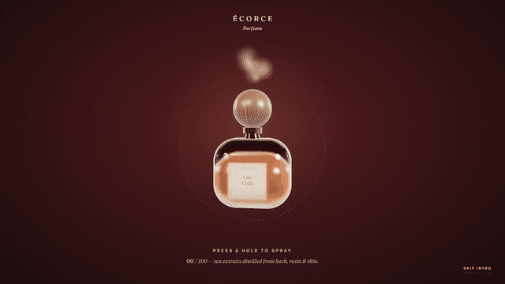</a>
       <b>Intro</b> — the bottle follows your cursor; press &amp; hold to spray, the mist blooms into the site
    </td>
    <td align="center" width="33%">
      
       <b>Carousel → fly-in</b> — drag the arc, click a bottle; it flies into its page while the others fall away
    </td>
    <td align="center" width="33%">
      <a href="https://perfume-ad-site.vercel.app/extrait/cuir-brule">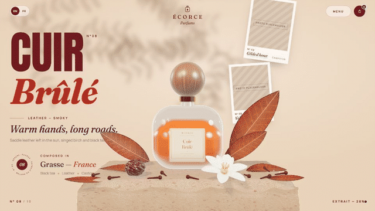</a>
       <b>Story</b> — the title bursts apart and the bottle makes a full 360° turn with your scroll
    </td>
  </tr>
</table>

### 👉 [Open the live site](https://perfume-ad-site.vercel.app) — hold to spray, drag the bottles, then open one and scroll.

---

## ✨ What's on the page

| | |
|---|---|
| 🌫️ **Intro** | A glass bottle trails the cursor over a dark stage; hold to spray WebGL mist while a gold ring fills; at 100% a cream bloom reveals the site |
| ⭐ **Home** | Ten procedural glass bottles on a diagonal arc over a rotating star seal; drag, wheel or arrow keys; colours blend between each scent's mood |
| ✈️ **Fly-in** | Click any bottle: it flies into its product page while the others fall away — the carousel pose and the hero pose are the same pose, so there is no jump |
| 🪨 **Still life** | The hero bottle stands on a travertine plinth with dried leaves, a gardenia, cloves and a plum, lit by a warm sun with real shadows |
| 📜 **Story** | The giant title bursts apart letter by letter; story words flip up while the bottle makes one full showcase turn |
| 🎡 **Other extraits** | A full-width concave arc of the other nine bottles; the hero bottle docks into a dashed “Yours” card. Click a card to fly to that scent |
| 🌀 **Into the scent** | A 3D tunnel of note words the bottle flies through |
| 🎼 **Composition** | Top, heart and base notes take turns while every note orbits the bottle on a ring of text |
| 📸 **Worn & wanted** | A draggable arc of campaign photos with Atelier / Campaign / Night / Skin filters |
| 🎨 **Ten moods → contact → footer** | A colour-study gallery, a dark contact section with cursor mist, a magnetic orb that sprays on click, copy-to-clipboard email, and a giant wordmark |
| ☰ **Menu** | A full-screen menu: the ten scents (each flies its bottle to its page), every section of the page, and contact |
| 🛍️ **Bag** | “Add to bag” on every scent opens a slide-in bag: quantities, subtotal and a demo checkout (nothing is charged). The bag is remembered between visits |
| 🇫🇷 **English / Français** | The EN / FR switch translates the whole site in place — copy, all ten scents and every note — without reloading or moving the bottle |
| 📱 **Phones** | Phone layouts for every section, touch swipe / tap / hold, lighter 3D (lower pixel ratio, lighter refraction, smaller textures) |

## 🖼️ Screenshots

<table>
  <tr>
    <td>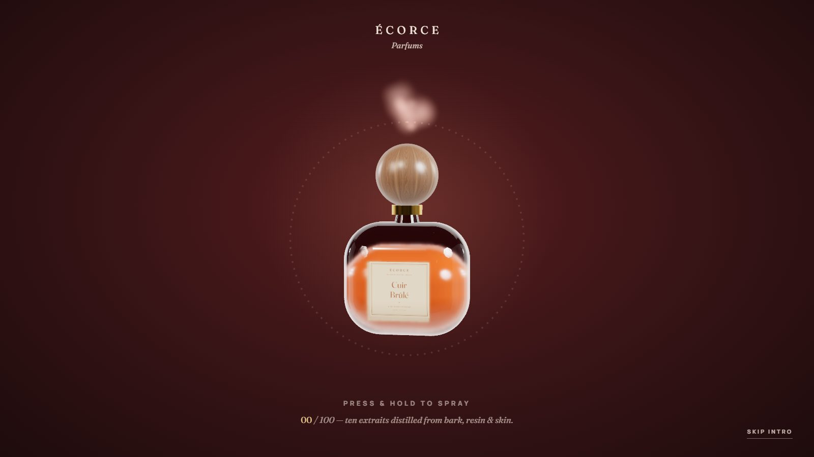</td>
    <td>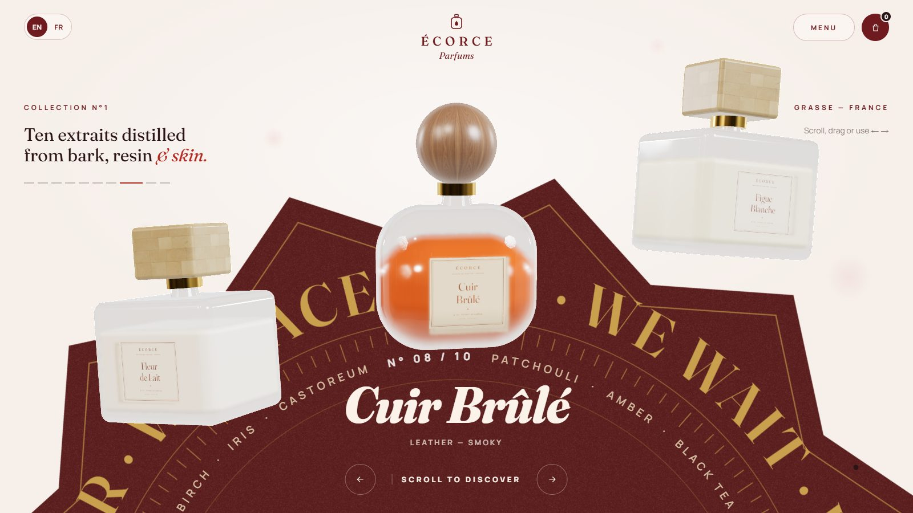</td>
  </tr>
  <tr>
    <td></td>
    <td>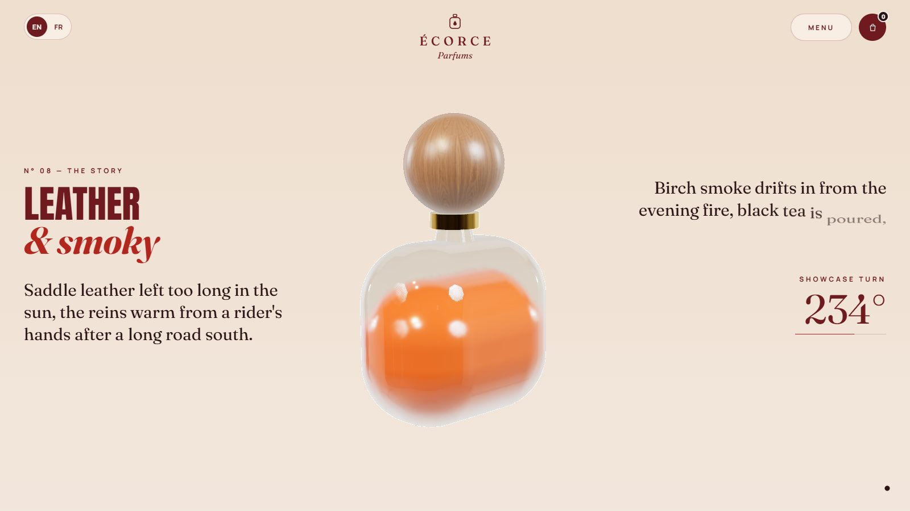</td>
  </tr>
  <tr>
    <td>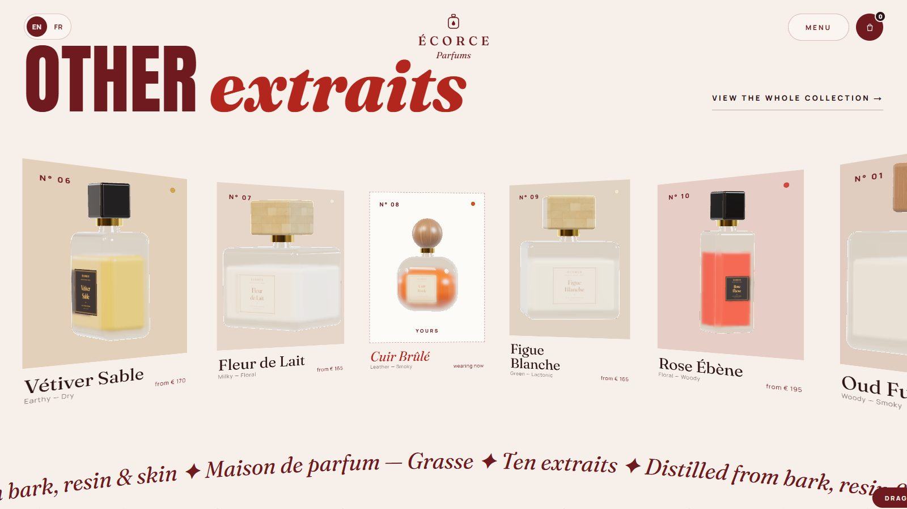</td>
    <td>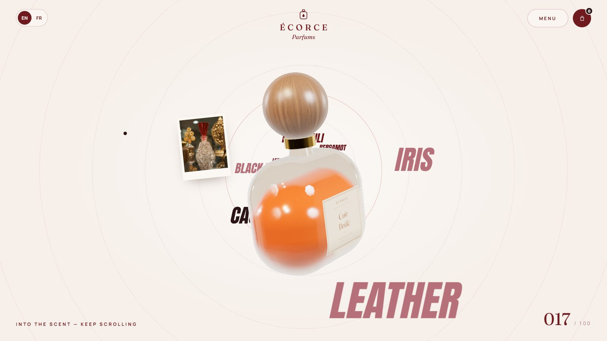</td>
  </tr>
  <tr>
    <td>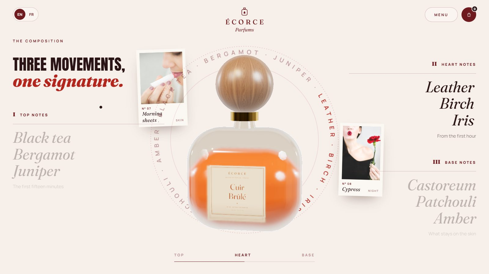</td>
    <td>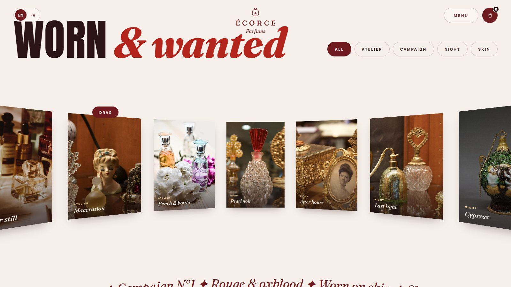</td>
  </tr>
  <tr>
    <td>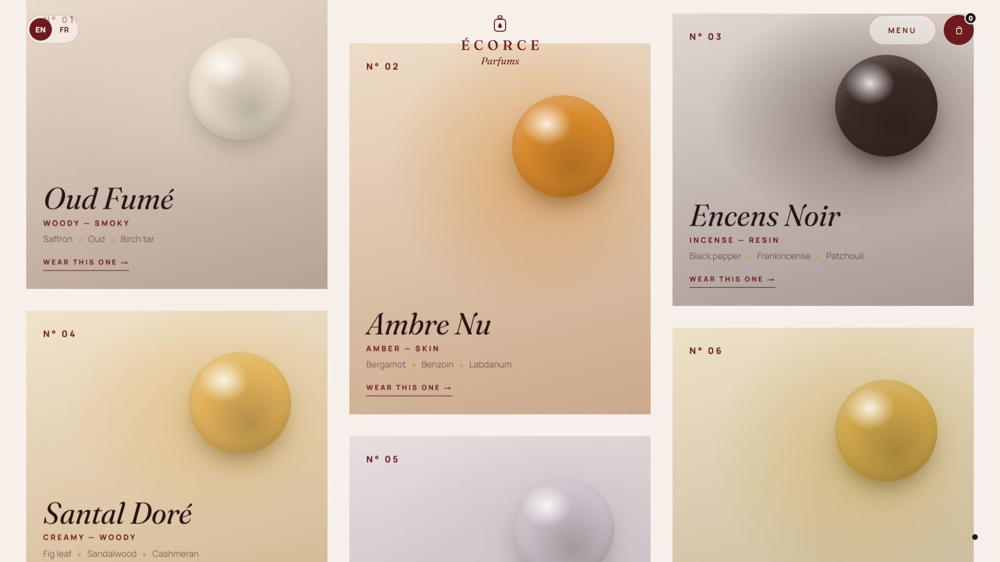</td>
    <td>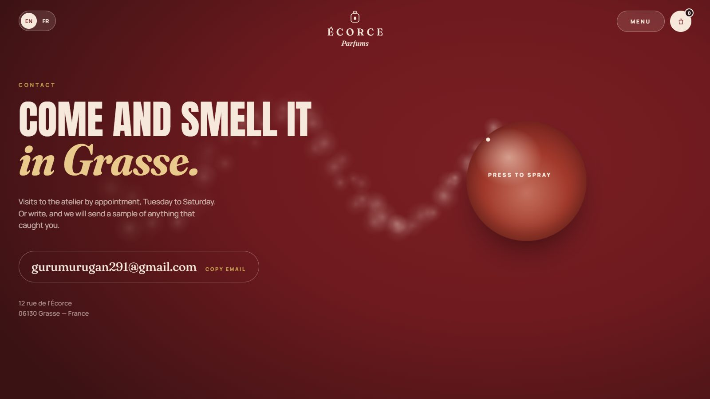</td>
  </tr>
  <tr>
    <td>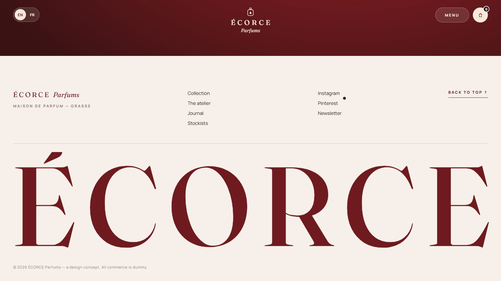</td>
    <td>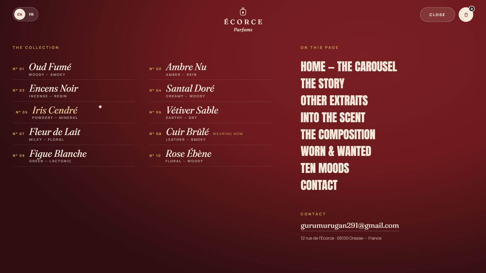</td>
  </tr>
  <tr>
    <td>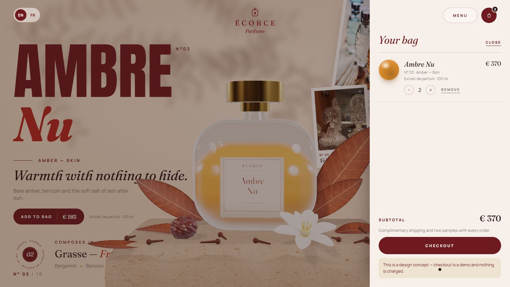</td>
    <td>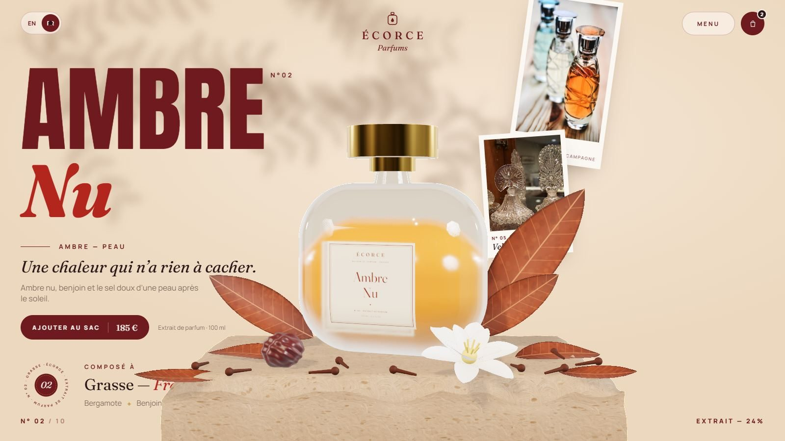</td>
  </tr>
</table>

**On a phone**

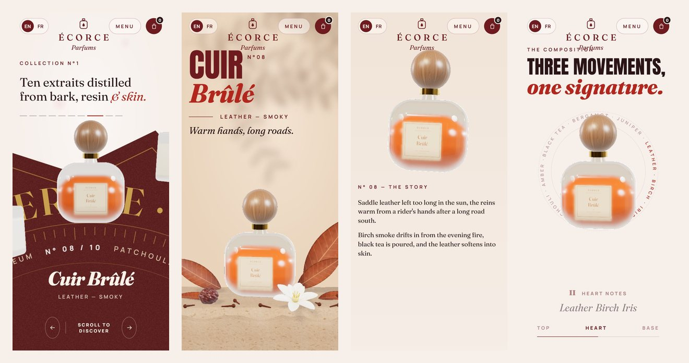

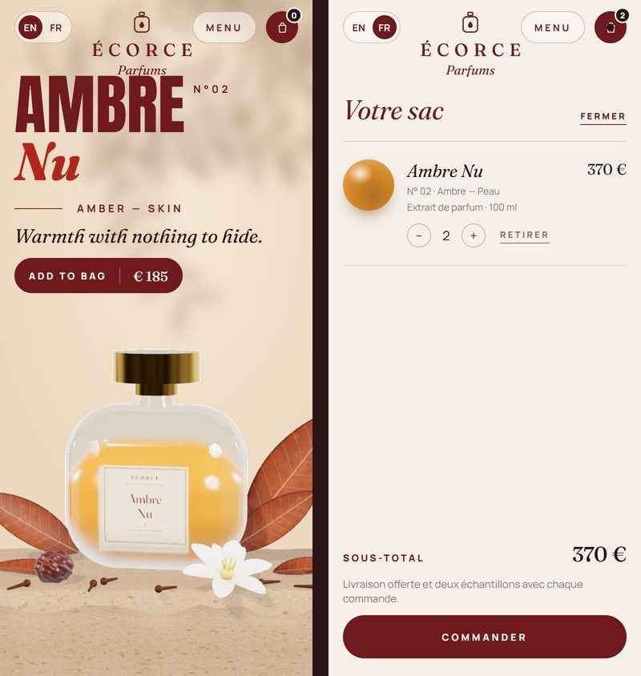

## 🧠 How it works

The short version — the full write-up is in **[docs/HOW-IT-WORKS.md](docs/HOW-IT-WORKS.md)**:

- **One canvas, one bottle.** A single fixed WebGL canvas never unmounts. The bottle follows invisible DOM placeholders
  section by section and interpolates between them, so it glides from the hero into the story, the card, the tunnel and the composition.
- **One clock.** Smooth scroll, scroll-triggered timelines, DOM updates and the 3D render all run on the same tick, in that order,
  so the page and the bottle never drift apart.
- **Render on demand.** Nothing is drawn while nothing moves. Idle pages cost almost nothing.
- **Real glass, tuned for a laptop GPU.** Glass uses refraction (transmission) with a backdrop only the glass can see, shaders are
  pre-compiled and textures uploaded behind the preloader, and phones get a lighter tier.
- **Two languages, one data file each.** All English copy lives in one data file; a French file overlays it. Switching language
  re-renders the text only — the 3D scene and the scroll position stay put. The bag and the chosen language are saved in the browser.

## 🛠️ How it builds

Stage-by-stage build log, tools and the performance fixes are in **[docs/HOW-IT-BUILDS.md](docs/HOW-IT-BUILDS.md)**.
In one line: Next.js (App Router, TypeScript) statically generates the home page and all ten product pages, and Vercel serves them.

## 📦 Assets in this repo

| Path | What |
|---|---|
| `docs/media/` | Animated 3D banner (SVG) and screen recordings (GIF) |
| `docs/screenshots/` | Desktop screenshots of every section and a phone strip |
| `assets/logo.svg` | The ÉCORCE logo |
| `assets/palette.svg` | The “Rouge Oxblood” palette |

> This repository is a showcase: screenshots, media, assets and the write-ups of how the site works and how it was built.
> The source code is kept private.

## 🙏 Credits

Studio HDRI and the plaster, walnut and marble textures: [Poly Haven](https://polyhaven.com) (CC0).
Campaign photos: free-licence perfume-bottle photos (CC0 / public domain) from rawpixel and Flickr, found via [Openverse](https://openverse.org).
Fonts: Fraunces, Manrope and Anton (SIL OFL). ÉCORCE is a fictional brand; all commerce is dummy UI.
